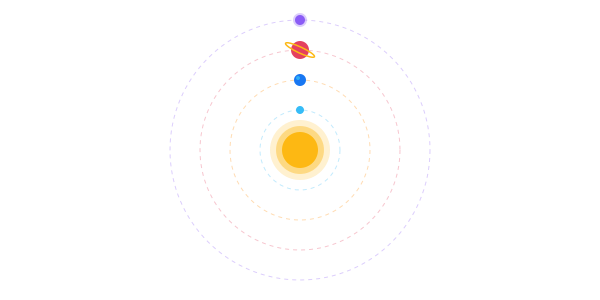

  

<h3 align="center">
  <samp>&gt; <i>"Exploring infinite data dimensions & engineering intelligent systems across the cosmos."</i></samp>
</h3>

  

  
  
  

 

  

## 🔭 Captain's Log // Transmission Entry

<table border="0" cellspacing="0" cellpadding="16" width="100%">
  <tr>
    <td bgcolor="#0B0C10" style="border: 1px solid #1F2833; border-radius: 8px;">
      

        Greetings, explorer. I am <b>Suraj Sawant</b> — a Data Science undergraduate & software engineer based in <b>Mumbai, India</b>. Orbiting at the intersection of <b>Machine Learning</b>, <b>Computer Vision</b>, and <b>Full-Stack Engineering</b>, my mission is architecting robust, scalable software capable of solving real-world challenges.
      

      

        🛰️ <b>Current Orbit:</b> B.Tech in Data Science &bull; Deepening expertise in Deep Learning, Computer Vision & MLOps 
        ⚙️ <b>Active Missions:</b> Developing <a href="#-flagship-missions-featured-projects"><b>SuRaksha</b></a> (AI UPI Fraud Detection) & <a href="#-flagship-missions-featured-projects"><b>AI Attendance Anomaly Detector</b></a> 
        🎯 <b>Prime Directive:</b> Turning raw multidimensional data into scalable, intelligent software systems.
      

    </td>
  </tr>
</table>

## 🚀 Flagship Missions (Featured Projects)

<table width="100%">
  <tr>
    <td width="50%" valign="top">
      <h3 align="left">🛡️ SuRaksha</h3>
      

        <b>AI-Powered UPI Fraud Detection Engine</b> 
        Real-time anomaly detection system built to analyze transactional velocity and user behavior patterns to identify and intercept fraudulent UPI behavior before execution.
      

      

        
        
        
        
      

      

        
      

    </td>
    <td width="50%" valign="top">
      <h3 align="left">📷 AI Attendance Anomaly Detector</h3>
      

        <b>Computer Vision Biometric Surveillance</b> 
        Automated attendance monitoring pipeline integrating real-time facial recognition, anti-spoofing liveness checks, and anomaly tracking for institutional management.
      

      

        
        
        
        
      

      

        
      

    </td>
  </tr>
  <tr>
    <td width="50%" valign="top">
      <h3 align="left">🧮 Scientific Engineering Calculator</h3>
      

        <b>High-Performance Algorithmic Math Engine</b> 
        Low-level mathematical computation tool architected in C++ using optimized data structures, shunting-yard infix parsing, and high-precision scientific arithmetic routines.
      

      

        
        
        
      

      

        
      

    </td>
    <td width="50%" valign="top">
      <h3 align="left">🔐 Password Vault</h3>
      

        <b>Zero-Knowledge Cryptographic Manager</b> 
        Local-first credential security vault applying AES-256 encryption, PBKDF2 key derivation, and zero-knowledge storage principles to defend sensitive accounts against leaks.
      

      

        
        
        
      

      

        
      

    </td>
  </tr>
</table>

## ⚙️ The Control Panel // Technical Arsenal

<b>Core Programming Languages</b>

  

<b>AI, Machine Learning & Data Science</b>

  

<b>Frontend & User Interface</b>

  

<b>Backend, Databases & Cloud</b>

  

<b>Hardware, Tools & Environment</b>

## 🛰️ Mission Control Telemetry

  
  
    
  
  
  

 

## 🌌 Orbital Trajectories (Activity)

  
<b>🛰️ Expand Contribution Constellation (Snake Animation)</b>

   
  

    <picture>
      <source media="(prefers-color-scheme: dark)" srcset="https://raw.githubusercontent.com/daystar-1nine/daystar-1nine/output/github-contribution-grid-snake-dark.svg">
      <source media="(prefers-color-scheme: light)" srcset="https://raw.githubusercontent.com/daystar-1nine/daystar-1nine/output/github-contribution-grid-snake.svg">
      
    </picture>
  

 

### ☄️ Recent Launches

<!--START_SECTION:activity-->
<!--END_SECTION:activity-->

 

## 🕹️ Mini-Game: Navigate the Asteroid Field

<table border="0" cellspacing="0" cellpadding="14" width="100%">
  <tr>
    <td align="center" bgcolor="#0B0C10" style="border: 1px solid #FDB813; border-radius: 8px;">
      <h3>🚨 MAYDAY! ASTEROID FIELD ENCOUNTERED 🚨</h3>
      

        Your spacecraft has strayed into an uncharted asteroid belt. Proximity alerts are blaring! 
        Do you possess the piloting maneuvers to navigate through the debris and discover the exoplanet?
      

      

        
      

      🎮 <i>Interactive multi-level story adventure crafted natively on GitHub!</i>
    </td>
  </tr>
</table>

 

  <h3>🪐 The Intergalactic Federation // Open for Collaboration ☄️</h3>
  

    <i>Always enthusiastic to collaborate across the globe on Machine Learning, Computer Vision, Full-Stack Applications, Open Source, and Hackathons!</i>
  

  

    
  

 

## 📡 Establish Comms Link // Connect Console

  
  
  
  
  
    
  
  
  

  

  ⚡ <i>"Look up at the stars and not down at your feet. Try to make sense of what you see, and wonder about what makes the universe exist. Be curious."</i> 
  <b>— Stephen Hawking</b>

  

  

